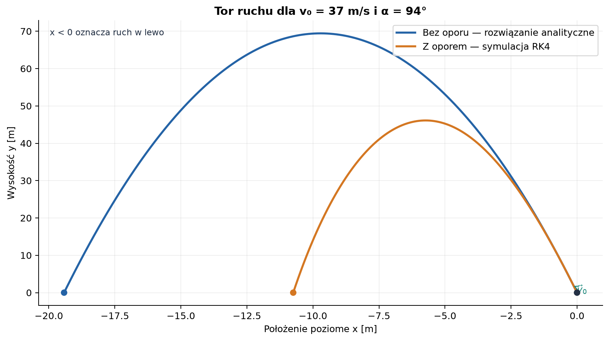
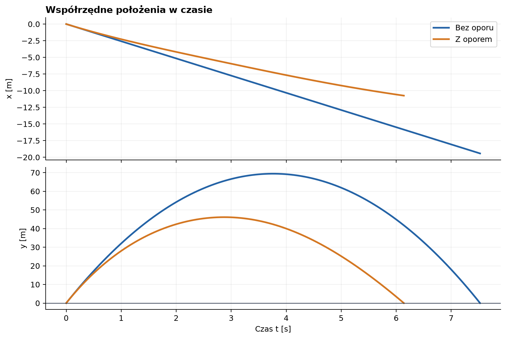
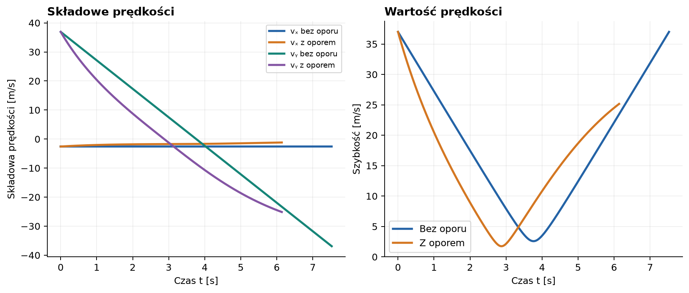
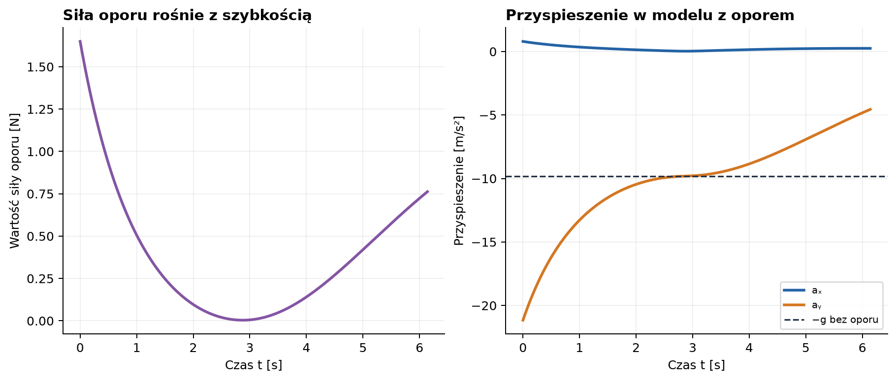
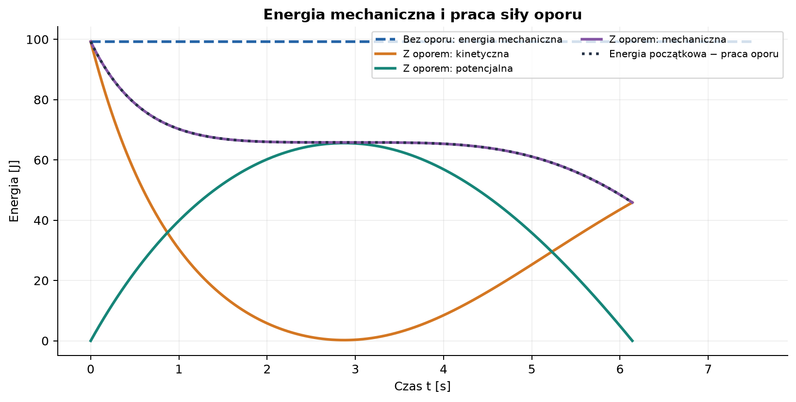
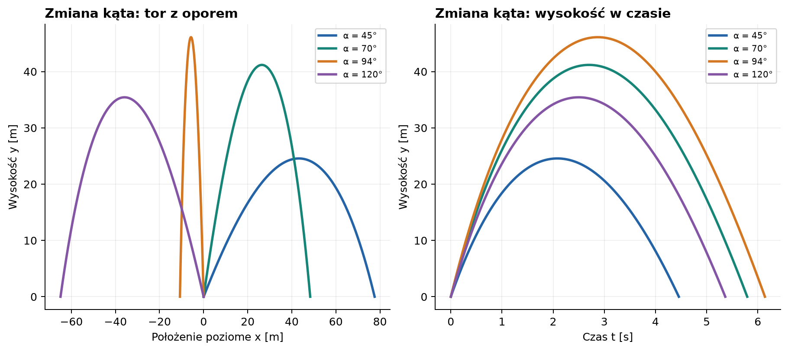

# Rzut ukośny — od modelu idealnego do oporu powietrza

*Raport obliczeniowy z wyprowadzeniem równań, symulacją numeryczną i wykresami.*

**Dane początkowe:** $v_0=37\,\mathrm{m/s}$, $\alpha=94^\circ$.  
**Metoda:** rozwiązanie analityczne bez oporu oraz całkowanie numeryczne dla oporu aerodynamicznego.  
**Charakter danych:** wykresy przedstawiają obliczenia modelowe, a nie pomiary.

> **Uwaga o kącie:** przyjmuję, że $\alpha=94^\circ$ jest mierzony od dodatniego kierunku osi poziomej $x$, przeciwnie do ruchu wskazówek zegara. Ponieważ kąt jest większy niż $90^\circ$, początkowa składowa pozioma prędkości jest ujemna: ciało wznosi się, poruszając się w lewo. Jeśli w zadaniu kąt miał być mierzony od innego kierunku, wyniki poziome trzeba odpowiednio przeliczyć.

## Spis treści

1. [Cel, układ współrzędnych i założenia](#1-cel-układ-współrzędnych-i-założenia)
2. [Rzut ukośny bez oporu powietrza](#2-rzut-ukośny-bez-oporu-powietrza)
3. [Opór powietrza i równania ruchu](#3-opór-powietrza-i-równania-ruchu)
4. [Wyniki dla podanych danych](#4-wyniki-dla-podanych-danych)
5. [Wykresy i interpretacja](#5-wykresy-i-interpretacja)
6. [Ograniczenia modelu](#6-ograniczenia-modelu)
7. [Kod i odtwarzanie wykresów](#7-kod-i-odtwarzanie-wykresów)
8. [Wnioski](#8-wnioski)
9. [Źródła](#9-źródła)

---

## 1. Cel, układ współrzędnych i założenia

Rzut ukośny jest ruchem w dwóch wymiarach, który można opisać jako niezależne ruchy wzdłuż osi poziomej i pionowej. Bez oporu przyspieszenie poziome jest równe zeru, a pionowe — przyspieszeniu grawitacyjnemu. Po uwzględnieniu oporu powietrza obie składowe prędkości wpływają na siłę oporu, dlatego ruch poziomy i pionowy stają się sprzężone.

### 1.1. Układ współrzędnych i dane

- Początek układu znajduje się w punkcie wyrzutu.
- Oś $x$ jest pozioma; jej dodatni zwrot wskazuje w prawo.
- Oś $y$ jest pionowa; jej dodatni zwrot wskazuje w górę.
- Poziom wyrzutu i lądowania jest taki sam: $y_0=0$.
- Kąt $\alpha$ mierzymy od dodatniej osi $x$.
- Przyspieszenie ziemskie przyjmujemy jako $g=9{,}81\,\mathrm{m/s^2}$.
- W modelu idealnym pomijamy opór powietrza. W modelu rozszerzonym zakładamy spokojne powietrze i kwadratową zależność oporu od szybkości.

### 1.2. Symbole i jednostki

| Symbol | Znaczenie | Jednostka SI |
| :--- | :--- | :---: |
| $x,y$ | współrzędne położenia | $\mathrm{m}$ |
| $v_x,v_y$ | składowe prędkości | $\mathrm{m/s}$ |
| $v=|\vec v|$ | szybkość | $\mathrm{m/s}$ |
| $a_x,a_y$ | składowe przyspieszenia | $\mathrm{m/s^2}$ |
| $v_0$ | szybkość początkowa | $\mathrm{m/s}$ |
| $\alpha$ | kąt wyrzutu | stopnie lub radiany |
| $g$ | wartość przyspieszenia ziemskiego | $\mathrm{m/s^2}$ |
| $m$ | masa ciała | $\mathrm{kg}$ |
| $\rho$ | gęstość powietrza | $\mathrm{kg/m^3}$ |
| $C_D$ | bezwymiarowy współczynnik oporu | $1$ |
| $A$ | pole powierzchni czołowej | $\mathrm{m^2}$ |
| $F_D$ | wartość siły oporu | $\mathrm{N}$ |

W całym raporcie wektor prędkości ma postać $\vec v=(v_x,v_y)$, a jego wartość wynosi $v=\sqrt{v_x^2+v_y^2}$.

## 2. Rzut ukośny bez oporu powietrza

### 2.1. Rozkład prędkości początkowej

Wektor prędkości początkowej rozkładamy na składowe:

$$
v_{0x}=v_0\cos\alpha,
\qquad
v_{0y}=v_0\sin\alpha.
$$

Dla podanych danych:

$$
v_{0x}=37\cos 94^\circ\approx-2{,}581\,\mathrm{m/s},
\qquad
v_{0y}=37\sin 94^\circ\approx36{,}910\,\mathrm{m/s}.
$$

Znak minus w $v_{0x}$ nie oznacza błędu: wynika z wybranego początku pomiaru kąta i wskazuje ruch w lewo.

### 2.2. Równania ruchu z drugiej zasady Newtona

Bez oporu jedyną siłą działającą po wyrzucie jest ciężar $\vec F_g=(0,-mg)$. Z drugiej zasady Newtona $m\vec a=\vec F$ wynika:

$$
m a_x=0,
\qquad
m a_y=-mg,
$$

czyli:

$$
a_x=0,
\qquad
a_y=-g.
$$

Ponieważ przyspieszenie jest pochodną prędkości, a prędkość pochodną położenia:

$$
\frac{dv_x}{dt}=0,\qquad \frac{dv_y}{dt}=-g,
\qquad
\frac{dx}{dt}=v_x,\qquad \frac{dy}{dt}=v_y.
$$

Całkując równania prędkości i podstawiając warunki początkowe $v_x(0)=v_{0x}$ oraz $v_y(0)=v_{0y}$, otrzymujemy:

$$
v_x(t)=v_0\cos\alpha,
\qquad
v_y(t)=v_0\sin\alpha-gt.
$$

Ponowne całkowanie, przy $x(0)=x_0$ i $y(0)=y_0$, daje:

$$
x(t)=x_0+v_0\cos\alpha\,t,
$$

$$
y(t)=y_0+v_0\sin\alpha\,t-\frac{1}{2}gt^2.
$$

W raporcie $x_0=y_0=0$. Eliminując czas z równań ($t=x/(v_0\cos\alpha)$), otrzymujemy równanie toru:

$$
y(x)=x\tan\alpha-\frac{g x^2}{2v_0^2\cos^2\alpha}.
$$

Jest to parabola, o ile $v_0\cos\alpha\ne0$. Gdy $\alpha=90^\circ$, ruch bez oporu jest dokładnie pionowy i nie należy dzielić przez $\cos\alpha=0$.

### 2.3. Czas lotu, wysokość maksymalna i zasięg

Dla tego samego poziomu startu i lądowania czas lotu wyznaczamy z warunku $y(T)=0$:

$$
v_0\sin\alpha\,T-\frac{1}{2}gT^2=0.
$$

Oprócz rozwiązania $T=0$ otrzymujemy czas powrotu:

$$
T=\frac{2v_0\sin\alpha}{g},
\qquad \text{dla } 0^\circ<\alpha<180^\circ.
$$

W najwyższym punkcie $v_y=0$. Stąd:

$$
t_{\max}=\frac{v_0\sin\alpha}{g},
\qquad
h_{\max}=\frac{(v_0\sin\alpha)^2}{2g}.
$$

Podstawiając czas lotu do $x(t)$, otrzymujemy poziomy zasięg ze znakiem:

$$
R=x(T)-x_0
=v_0\cos\alpha\frac{2v_0\sin\alpha}{g}
=\frac{v_0^2\sin(2\alpha)}{g}.
$$

Dla kąta ostrego $R>0$, a dla kąta rozwartego $R<0$: ciało ląduje po przeciwnej stronie punktu wyrzutu. Odległość od punktu wyrzutu jest wtedy równa $|R|$.

### 2.4. Prędkość i energia w modelu idealnym

W dowolnej chwili:

$$
v(t)=\sqrt{v_x(t)^2+v_y(t)^2}
=\sqrt{(v_0\cos\alpha)^2+(v_0\sin\alpha-gt)^2}.
$$

W najwyższym punkcie składowa pionowa znika, ale pozioma pozostaje stała:

$$
v_{\mathrm{wierzchołek}}=|v_0\cos\alpha|.
$$

Jeśli poziom $y=0$ jest poziomem odniesienia energii potencjalnej, suma energii kinetycznej i potencjalnej wynosi:

$$
E=\frac{1}{2}m(v_x^2+v_y^2)+mgy=\mathrm{const}.
$$

W modelu bez oporu szybkość przy lądowaniu jest równa szybkości początkowej, gdy punkt lądowania znajduje się na tej samej wysokości.

## 3. Opór powietrza i równania ruchu

### 3.1. Model kwadratowy

Wartość siły aerodynamicznej dla ciała poruszającego się względem nieruchomego powietrza modelujemy zależnością:

$$
F_D=\frac{1}{2}\rho C_D A v^2.
$$

Siła jest skierowana przeciwnie do prędkości, dlatego jej zapis wektorowy ma postać:

$$
\vec F_D=-\frac{1}{2}\rho C_D A\,|\vec v|\,\vec v.
$$

Czynnik $|\vec v|$ jest potrzebny, aby wartość siły była proporcjonalna do $v^2$, natomiast kierunek i zwrot wektora siły były przeciwne do ruchu. Wprowadzamy:

$$
\beta=\frac{\rho C_D A}{2m}.
$$

Po podzieleniu drugiej zasady Newtona przez masę otrzymujemy wektorowe równanie ruchu:

$$
\frac{d\vec v}{dt}=\vec g-\beta|\vec v|\vec v,
\qquad \vec g=(0,-g).
$$

W składowych układ równań przyjmuje postać:

$$
\dot{x}=v_x,\qquad \dot{y}=v_y,
$$

$$
\dot{v}_x=-\beta\sqrt{v_x^2+v_y^2}\,v_x,
$$

$$
\dot{v}_y=-g-\beta\sqrt{v_x^2+v_y^2}\,v_y.
$$

To właśnie wspólna wartość $\sqrt{v_x^2+v_y^2}$ sprzęga oba kierunki ruchu. Przy wznoszeniu opór zmniejsza składową skierowaną w górę; podczas opadania ma składową skierowaną w górę i ogranicza wzrost szybkości spadania.

### 3.2. Dlaczego potrzebna jest symulacja numeryczna?

W modelu liniowym (stałe $g$ i brak oporu) składowe można całkować osobno i uzyskać wzory jawne. Przy oporze kwadratowym przyspieszenie zależy od obu składowych prędkości przez ich wartość $v$. Dla ogólnego rzutu nie dostajemy prostego, użytecznego wzoru elementarnego na cały tor. W raporcie rozwiązujemy zatem układ równań metodą Rungego–Kutty czwartego rzędu (RK4).

Dla układu $\dot{\mathbf{s}}=\mathbf{f}(t,\mathbf{s})$, gdzie $\mathbf{s}=(x,y,v_x,v_y)$, pojedynczy krok o długości $\Delta t$ obliczamy jako:

$$
\begin{aligned}
k_1&=\mathbf{f}(t_n,\mathbf{s}_n),\\
k_2&=\mathbf{f}\left(t_n+\frac{\Delta t}{2},
              \mathbf{s}_n+\frac{\Delta t}{2}k_1\right),\\
k_3&=\mathbf{f}\left(t_n+\frac{\Delta t}{2},
              \mathbf{s}_n+\frac{\Delta t}{2}k_2\right),\\
k_4&=\mathbf{f}(t_n+\Delta t,\mathbf{s}_n+\Delta t\,k_3),\\
\mathbf{s}_{n+1}&=\mathbf{s}_n+
\frac{\Delta t}{6}(k_1+2k_2+2k_3+k_4).
\end{aligned}
$$

Symulację kończymy, gdy ciało ponownie osiągnie $y=0$. Ostatni krok jest interpolowany do poziomu gruntu, aby dokładniej oszacować czas i położenie lądowania.

### 3.3. Dodatkowe parametry aerodynamiczne

Podane przez użytkownika $v_0$ i $\alpha$ wystarczają do modelu bez oporu, ale nie wystarczają do wyznaczenia ruchu z oporem. Potrzebne są także masa, rozmiar i kształt ciała oraz właściwości powietrza. Aby wykonać porównywalny przykład, przyjmuję model gładkiej kuli:

| Parametr | Wartość przyjęta w obliczeniach | Uwagi |
| :--- | ---: | :--- |
| $m$ | $0{,}145\,\mathrm{kg}$ | masa przykładowego ciała |
| $d$ | $0{,}073\,\mathrm{m}$ | średnica kuli |
| $A=\pi d^2/4$ | $0{,}004185\,\mathrm{m^2}$ | pole przekroju czołowego |
| $C_D$ | $0{,}47$ | przybliżony współczynnik oporu kuli |
| $\rho$ | $1{,}225\,\mathrm{kg/m^3}$ | gęstość powietrza w przybliżonych warunkach standardowych |
| $g$ | $9{,}81\,\mathrm{m/s^2}$ | przyspieszenie ziemskie |
| $\Delta t$ | $0{,}002\,\mathrm{s}$ | krok całkowania RK4 |

Z tych wartości wynika $\beta\approx0{,}00981\,\mathrm{m^{-1}}$. Są to **założenia ilustracyjne**, a nie dane zmierzone dla konkretnego przedmiotu. Współczynnik $C_D$ w rzeczywistości zależy między innymi od kształtu, orientacji, prędkości i przepływu.

Przy pionowym spadaniu, gdy opór równoważy ciężar, przyspieszenie jest zerowe. Z warunku $mg=\frac12\rho C_D A v_{\mathrm{gr}}^2$ wynika graniczna szybkość modelu:

$$
v_{\mathrm{gr}}=\sqrt{\frac{2mg}{\rho C_D A}}
=\sqrt{\frac{g}{\beta}}
\approx34{,}36\,\mathrm{m/s}.
$$

Jest to graniczna szybkość dla pionowego spadania w przyjętym modelu, a nie szybkość graniczna całego ukośnego toru.

## 4. Wyniki dla podanych danych

### 4.1. Przypadek bez oporu

Dla $v_0=37\,\mathrm{m/s}$, $\alpha=94^\circ$, $y_0=0$ oraz $g=9{,}81\,\mathrm{m/s^2}$:

| Wielkość | Wynik | Znaczenie |
| :--- | ---: | :--- |
| $v_{0x}$ | $-2{,}581\,\mathrm{m/s}$ | początkowy ruch w lewo |
| $v_{0y}$ | $36{,}910\,\mathrm{m/s}$ | początkowy ruch w górę |
| Czas do wierzchołka | $3{,}762\,\mathrm{s}$ | moment, gdy $v_y=0$ |
| Maksymalna wysokość | $69{,}436\,\mathrm{m}$ | ponad poziomem wyrzutu |
| Czas lotu | $7{,}525\,\mathrm{s}$ | powrót na poziom wyrzutu |
| Zasięg ze znakiem | $-19{,}422\,\mathrm{m}$ | lądowanie w lewo |
| Szybkość przy lądowaniu | $37{,}000\,\mathrm{m/s}$ | taka sama jak początkowa |

Wartość bezwzględna zasięgu to $19{,}422\,\mathrm{m}$. Kąt $94^\circ$ jest bliski pionowemu, więc początkowa składowa pozioma jest niewielka. Ujemny zasięg wynika z kierunku tej składowej.

### 4.2. Przypadek z oporem

Dla parametrów kuli z sekcji 3.3, numerycznego kroku $\Delta t=0{,}002\,\mathrm{s}$ oraz tych samych warunków początkowych otrzymujemy:

| Wielkość | Bez oporu | Z oporem | Zmiana w modelu z oporem |
| :--- | ---: | ---: | ---: |
| Maksymalna wysokość | $69{,}436\,\mathrm{m}$ | $46{,}111\,\mathrm{m}$ | spadek o ok. $33{,}6\%$ |
| Czas lotu | $7{,}525\,\mathrm{s}$ | $6{,}139\,\mathrm{s}$ | spadek o ok. $18{,}4\%$ |
| Zasięg ze znakiem | $-19{,}422\,\mathrm{m}$ | $-10{,}746\,\mathrm{m}$ | krótszy lot w lewo |
| Szybkość przy lądowaniu | $37{,}000\,\mathrm{m/s}$ | $25{,}156\,\mathrm{m/s}$ | mniejsza niż początkowa |
| $v_x$ przy lądowaniu | $-2{,}581\,\mathrm{m/s}$ | $-1{,}187\,\mathrm{m/s}$ | składowa pozioma osłabiona |
| $v_y$ przy lądowaniu | $-36{,}910\,\mathrm{m/s}$ | $-25{,}128\,\mathrm{m/s}$ | opadanie wolniejsze niż bez oporu |

Porównanie procentowe dotyczy wartości maksymalnej wysokości, czasu oraz **wartości bezwzględnej** zasięgu. Opór zmienia prędkość w obu kierunkach, przez co tor z oporem nie jest symetryczną parabolą.

## 5. Wykresy i interpretacja

Wykresy wygenerowano w Pythonie, korzystając z NumPy i Matplotlib. W modelu z oporem zastosowano własną implementację RK4. Wszystkie ilustracje są plikami PNG zapisanymi obok raportu.

### 5.1. Tor ruchu: modele bez oporu i z oporem



*Rysunek 1. Bez oporu tor jest parabolą. Z oporem wznoszenie i opadanie nie są symetryczne; ciało ląduje bliżej punktu wyrzutu.*

### 5.2. Współrzędne położenia w czasie



*Rysunek 2. Współrzędna pozioma jest ujemna, ponieważ $\alpha=94^\circ$. W obu modelach wysokość osiąga maksimum, a następnie ciało wraca na poziom wyrzutu.*

### 5.3. Składowe i wartość prędkości



*Rysunek 3. Bez oporu $v_x$ jest stała, a $v_y$ maleje liniowo. Przy oporze zmieniają się obie składowe. W najwyższym punkcie $v_y=0$, ale szybkość nie jest zerowa.*

### 5.4. Siła oporu i przyspieszenie



*Rysunek 4. Siła oporu jest największa wtedy, gdy ciało porusza się szybko. Przyspieszenie pionowe nie jest stałe: podczas wznoszenia grawitacja i opór skierowane są w dół, a podczas opadania opór działa ku górze.*

### 5.5. Energia mechaniczna i praca oporu



*Rysunek 5. W modelu z oporem energia mechaniczna maleje. Utrata energii odpowiada pracy wykonanej przez siłę oporu. W modelu idealnym suma energii kinetycznej i potencjalnej pozostaje stała.*

Moc siły oporu wynosi:

$$
P_D=\vec F_D\cdot\vec v
=-\frac{1}{2}\rho C_D A\,v^3\le0.
$$

Zatem:

$$
\frac{dE_{\mathrm{mech}}}{dt}=P_D,
\qquad
W_{\mathrm{rozproszone}}(t)=
\int_0^t\frac{1}{2}\rho C_D A\,v(\tau)^3\,d\tau.
$$

Wykres pokazuje, że $E_{\mathrm{mech}}+W_{\mathrm{rozproszone}}$ pozostaje w przybliżeniu równe energii początkowej. Dla zastosowanego kroku całkowania błąd numerycznego bilansu energii na końcu lotu wyniósł około $3{,}2\cdot10^{-5}\,\mathrm{J}$.

### 5.6. Wpływ kąta wyrzutu



*Rysunek 6. Zmiana kąta wpływa jednocześnie na składową poziomą i pionową prędkości. Kąty większe niż $90^\circ$ oznaczają początkowy ruch w lewo.*

## 6. Ograniczenia modelu

- Przyjęto stałą gęstość powietrza, stały współczynnik $C_D$ i stałe pole przekroju.
- Pominięto wiatr, obrót ciała, siłę Magnusa, wypór oraz zmianę temperatury i ciśnienia z wysokością.
- Model kuli jest przykładowy. Dla rzeczywistego przedmiotu należy podstawić jego masę, geometrię i odpowiedni współczynnik oporu.
- Współczynnik oporu może zależeć od liczby Reynoldsa i może zmieniać się na torze; stałe $C_D$ jest uproszczeniem.
- Lądowanie zdefiniowano jako pierwsze ponowne przecięcie poziomu $y=0$. Teren przyjęto jako płaski, a wysokość wyrzutu równą wysokości lądowania.
- Wykresy pokazują wynik obliczeń modelowych, nie wynik doświadczenia. Rzeczywiste dane mogą różnić się od nich.

## 7. Kod i odtwarzanie wykresów

Poniższy kompletny skrypt generuje wszystkie sześć wykresów. Kod znajduje się w tym raporcie, więc nie jest wymagany żaden dodatkowy plik źródłowy. Do jego uruchomienia potrzebne są Python 3, NumPy i Matplotlib.

W terminalu, stojąc w katalogu `pages/solutions/04_sol_vscode`, można zapisać poniższy blok jako `generuj_wykresy.py`, a następnie wykonać:

```bash
python -m pip install numpy matplotlib
python generuj_wykresy.py
```

W Google Colabie wklej cały kod do jednej komórki i uruchom ją; jeśli biblioteki nie są zainstalowane, przedtem wykonaj `!pip install numpy matplotlib`. Skrypt zapisuje obrazy do `files/rzut_ukosny/`. Jeżeli uruchamiasz go w innym katalogu, zmień `OUT` na ścieżkę, w której mają powstać pliki.

```python
from pathlib import Path

import matplotlib
matplotlib.use("Agg")
import matplotlib.pyplot as plt
import numpy as np


OUT = Path("files") / "rzut_ukosny"
OUT.mkdir(parents=True, exist_ok=True)

g = 9.81
v0 = 37.0
alpha_deg = 94.0
alpha = np.deg2rad(alpha_deg)
m = 0.145
d = 0.073
Cd = 0.47
rho = 1.225
A = np.pi * d**2 / 4
beta = 0.5 * rho * Cd * A / m
dt = 0.002

BLUE, ORANGE, GREEN = "#2463A6", "#D47722", "#168578"
PURPLE, INK = "#8455A4", "#233044"
plt.rcParams.update({
    "font.family": "DejaVu Sans",
    "font.size": 10,
    "axes.titlesize": 12,
    "axes.titleweight": "bold",
    "axes.spines.top": False,
    "axes.spines.right": False,
    "axes.grid": True,
    "grid.alpha": 0.2,
    "lines.linewidth": 2.2,
    "figure.facecolor": "white",
    "savefig.facecolor": "white",
})


def save(fig, name):
    fig.savefig(OUT / f"{name}.png", dpi=180, bbox_inches="tight")
    plt.close(fig)


def simulate(angle_deg, step=dt):
    angle = np.deg2rad(angle_deg)
    state = np.array([0.0, 0.0, v0 * np.cos(angle), v0 * np.sin(angle)])
    times = [0.0]
    states = [state.copy()]

    def derivative(s):
        x, y, vx, vy = s
        speed = np.hypot(vx, vy)
        return np.array([
            vx,
            vy,
            -beta * speed * vx,
            -g - beta * speed * vy,
        ])

    for _ in range(100_000):
        k1 = derivative(state)
        k2 = derivative(state + 0.5 * step * k1)
        k3 = derivative(state + 0.5 * step * k2)
        k4 = derivative(state + step * k3)
        next_state = state + step * (k1 + 2*k2 + 2*k3 + k4) / 6
        next_time = times[-1] + step
        if next_state[1] <= 0 and next_time > 0:
            fraction = states[-1][1] / (states[-1][1] - next_state[1])
            state = states[-1] + fraction * (next_state - states[-1])
            times.append(times[-1] + fraction * step)
            states.append(state.copy())
            break
        state = next_state
        times.append(next_time)
        states.append(state.copy())
    else:
        raise RuntimeError("Nie znaleziono chwili upadku w limicie symulacji.")

    return np.asarray(times), np.asarray(states)


def ideal(angle_deg):
    angle = np.deg2rad(angle_deg)
    vx = v0 * np.cos(angle)
    vy = v0 * np.sin(angle)
    flight = 2 * vy / g
    time = np.linspace(0, flight, 1000)
    x = vx * time
    y = vy * time - 0.5 * g * time**2
    return time, x, y, np.full_like(time, vx), vy - g*time


t, s = simulate(alpha_deg)
x, y, vx, vy = s.T
speed = np.hypot(vx, vy)
ax_drag = -beta * speed * vx
ay_drag = -g - beta * speed * vy
drag_force = m * beta * speed**2

t0, x0, y0, vx0, vy0 = ideal(alpha_deg)
flight_ideal = 2 * v0 * np.sin(alpha) / g
height_ideal = (v0 * np.sin(alpha))**2 / (2*g)
range_ideal = v0**2 * np.sin(2*alpha) / g
height_drag = np.max(y)

fig, ax = plt.subplots(figsize=(9, 5), layout="constrained")
ax.plot(x0, y0, color=BLUE, label="Bez oporu — rozwiązanie analityczne")
ax.plot(x, y, color=ORANGE, label="Z oporem — symulacja RK4")
ax.scatter([0, x0[-1], x[-1]], [0, 0, 0],
           color=[INK, BLUE, ORANGE], zorder=4, s=35)
ax.annotate(r"$\vec{v}_0$", xy=(1.8*np.cos(alpha), 1.8*np.sin(alpha)),
            xytext=(0, 0), arrowprops={"arrowstyle": "->", "color": GREEN},
            color=GREEN)
ax.set(xlabel="Położenie poziome x [m]", ylabel="Wysokość y [m]")
ax.set_title("Tor ruchu dla v₀ = 37 m/s i α = 94°")
ax.legend()
ax.text(0.02, 0.97, "x < 0 oznacza ruch w lewo", transform=ax.transAxes,
        va="top", fontsize=9, color=INK)
save(fig, "01_tor_porownanie")

fig, axes = plt.subplots(2, 1, figsize=(9, 6), sharex=True,
                         layout="constrained")
axes[0].plot(t0, x0, color=BLUE, label="Bez oporu")
axes[0].plot(t, x, color=ORANGE, label="Z oporem")
axes[0].set_ylabel("x [m]")
axes[0].set_title("Współrzędne położenia w czasie", loc="left")
axes[0].legend()
axes[1].plot(t0, y0, color=BLUE, label="Bez oporu")
axes[1].plot(t, y, color=ORANGE, label="Z oporem")
axes[1].set(xlabel="Czas t [s]", ylabel="y [m]")
axes[1].axhline(0, color=INK, lw=0.8)
save(fig, "02_polozenie_czas")

fig, axes = plt.subplots(1, 2, figsize=(10, 4.2), layout="constrained")
axes[0].plot(t0, vx0, color=BLUE, label="vₓ bez oporu")
axes[0].plot(t, vx, color=ORANGE, label="vₓ z oporem")
axes[0].plot(t0, vy0, color=GREEN, label="vᵧ bez oporu")
axes[0].plot(t, vy, color=PURPLE, label="vᵧ z oporem")
axes[0].set(xlabel="Czas t [s]", ylabel="Składowa prędkości [m/s]")
axes[0].set_title("Składowe prędkości", loc="left")
axes[0].legend(fontsize=8)
axes[1].plot(t0, np.hypot(vx0, vy0), color=BLUE, label="Bez oporu")
axes[1].plot(t, speed, color=ORANGE, label="Z oporem")
axes[1].set(xlabel="Czas t [s]", ylabel="Szybkość [m/s]")
axes[1].set_title("Wartość prędkości", loc="left")
axes[1].legend()
save(fig, "03_predkosc")

fig, axes = plt.subplots(1, 2, figsize=(10, 4.2), layout="constrained")
axes[0].plot(t, drag_force, color=PURPLE)
axes[0].set(xlabel="Czas t [s]", ylabel="Wartość siły oporu [N]")
axes[0].set_title("Siła oporu rośnie z szybkością", loc="left")
axes[1].plot(t, ax_drag, color=BLUE, label="aₓ")
axes[1].plot(t, ay_drag, color=ORANGE, label="aᵧ")
axes[1].axhline(-g, color=INK, ls="--", lw=1.3, label="−g bez oporu")
axes[1].set(xlabel="Czas t [s]", ylabel="Przyspieszenie [m/s²]")
axes[1].set_title("Przyspieszenie w modelu z oporem", loc="left")
axes[1].legend(fontsize=8)
save(fig, "04_sila_przyspieszenie")

kinetic = 0.5 * m * speed**2
potential = m * g * y
mechanical = kinetic + potential
power_lost = m * beta * speed**3
lost = np.zeros_like(t)
lost[1:] = np.cumsum(0.5 * (power_lost[:-1] + power_lost[1:]) * np.diff(t))
ideal_energy = 0.5 * m * v0**2

fig, ax = plt.subplots(figsize=(9, 4.5), layout="constrained")
ax.plot(t0, np.full_like(t0, ideal_energy), color=BLUE, ls="--",
        label="Bez oporu: energia mechaniczna")
ax.plot(t, kinetic, color=ORANGE, label="Z oporem: kinetyczna")
ax.plot(t, potential, color=GREEN, label="Z oporem: potencjalna")
ax.plot(t, mechanical, color=PURPLE, label="Z oporem: mechaniczna")
ax.plot(t, mechanical[0] - lost, color=INK, ls=":",
        label="Energia początkowa − praca oporu")
ax.set(xlabel="Czas t [s]", ylabel="Energia [J]")
ax.set_title("Energia mechaniczna i praca siły oporu")
ax.legend(fontsize=8, ncol=2)
save(fig, "05_energia")

fig, axes = plt.subplots(1, 2, figsize=(10, 4.4), layout="constrained")
for angle_deg, color in [(45, BLUE), (70, GREEN), (94, ORANGE), (120, PURPLE)]:
    ta, sa = simulate(angle_deg)
    axes[0].plot(sa[:, 0], sa[:, 1], color=color, label=f"α = {angle_deg}°")
    axes[1].plot(ta, sa[:, 1], color=color, label=f"α = {angle_deg}°")
axes[0].set(xlabel="Położenie poziome x [m]", ylabel="Wysokość y [m]")
axes[0].set_title("Zmiana kąta: tor z oporem", loc="left")
axes[1].set(xlabel="Czas t [s]", ylabel="Wysokość y [m]")
axes[1].set_title("Zmiana kąta: wysokość w czasie", loc="left")
for ax in axes:
    ax.legend(fontsize=8)
save(fig, "06_wplyw_kata")

print(f"v₀x = {v0*np.cos(alpha):.4f} m/s; v₀y = {v0*np.sin(alpha):.4f} m/s")
print(f"Bez oporu: lot = {flight_ideal:.4f} s, "
      f"h_max = {height_ideal:.4f} m, zasięg x = {range_ideal:.4f} m")
print(f"Z oporem: lot = {t[-1]:.4f} s, h_max = {height_drag:.4f} m, "
      f"zasięg x = {x[-1]:.4f} m, v_k = {speed[-1]:.4f} m/s")
print(f"Składowe prędkości przy upadku: vx = {vx[-1]:.4f} m/s, "
      f"vy = {vy[-1]:.4f} m/s")
print(f"v_graniczna (spadanie) = {np.sqrt(g/beta):.4f} m/s")
energy_balance = mechanical[-1] + lost[-1] - mechanical[0]
assert abs(energy_balance) < 1e-3
print(f"Bilans energii: E_koniec + W_rozproszone - E_początek = "
      f"{energy_balance:.3e} J")
print(f"Wykresy zapisano w: {OUT.resolve()}")
```

## 8. Wnioski

1. Dla kąta $94^\circ$ wektor początkowej prędkości jest skierowany prawie pionowo w górę i nieznacznie w lewo. W konsekwencji współrzędna pozioma oraz zasięg ze znakiem są ujemne.
2. Bez oporu równania ruchu można rozwiązać analitycznie. Dla podanych danych lot trwa około $7{,}525\,\mathrm{s}$, ciało osiąga wysokość około $69{,}436\,\mathrm{m}$ i ląduje około $19{,}422\,\mathrm{m}$ na lewo od punktu wyrzutu.
3. Opór aerodynamiczny zależy od masy, pola przekroju, kształtu i warunków powietrza. Ponieważ te dane nie zostały podane, wyniki z oporem są warunkowe i bazują na jawnie wymienionych założeniach dla kuli.
4. W przyjętym modelu kuli opór obniża maksymalną wysokość do około $46{,}111\,\mathrm{m}$ oraz skraca lot do około $6{,}139\,\mathrm{s}$. Zmienia też obie składowe prędkości.
5. W modelu idealnym energia mechaniczna jest zachowana. W modelu z oporem jej ubytek jest zgodny z pracą siły oporu; niewielka różnica w bilansie wynika z numerycznego całkowania.

## 9. Źródła

- [OpenStax, University Physics Volume 1 — Projectile Motion](https://openstax.org/books/university-physics-volume-1/pages/4-3-projectile-motion) — rozkład ruchu na składowe i równania rzutu bez oporu.
- [NASA Glenn Research Center — The Drag Equation](https://www1.grc.nasa.gov/beginners-guide-to-aeronautics/drag-equation/) — równanie siły oporu i znaczenie parametrów aerodynamicznych.